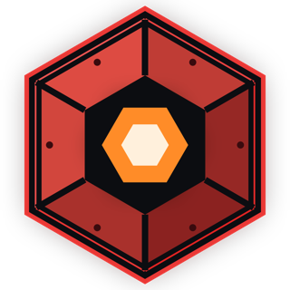
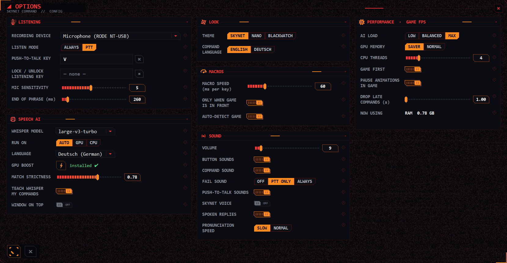

<h1 align="center">SKYNET COMMAND</h1>

<b>Voice macros for games, powered by the Whisper speech AI</b> 
Say <i>"hellbomb"</i>, <i>"orbital laser"</i>, <i>"resupply"</i> and the stratagem is typed in for you.

<a href="https://github.com/Salutemadeo/SkynetCommand/raw/main/download/SkynetCommand.zip"><b>⬇ DOWNLOAD (Windows)</b></a>

Made by <b>Salutem</b> · <a href="https://steamcommunity.com/id/hecton/">Steam</a> · Discord: <code>hekton</code>

> [!IMPORTANT]
> **THIS APP IS FREE. IT CANNOT BE SOLD.** If you paid for it, you were scammed.
> License: [PolyForm Noncommercial 1.0.0](LICENSE.txt). Free to use, share and change for noncommercial purposes.

## Download & install (Windows 10 / 11)

1. **[⬇ Download SkynetCommand.zip](https://github.com/Salutemadeo/SkynetCommand/raw/main/download/SkynetCommand.zip)** and unzip it anywhere (e.g. Documents). Don't run it from inside the zip.
   *(or: green **Code** button → **Download ZIP** - same files)*
2. Double-click **`1 - SETUP (run once).bat`**. It needs internet once (~5 minutes) and puts a private Python and the speech engine **inside that folder**. Nothing is installed in Windows.
3. Start it with the **Skynet Command** shortcut (hex icon). The first start downloads the speech model once.

If Windows says *"Windows protected your PC"*, click **More info → Run anyway** (the scripts are plain text, you can read them in `app\install.ps1`).

**NVIDIA graphics card?** Run `GPU boost (NVIDIA only).bat` (~1 GB) for the bigger, more accurate model on your GPU.

**Uninstall:** delete the folder (and the Desktop shortcut if you made one).

## Features

- **All Helldivers 2 stratagems** built in with arrow codes, full names and code names (*"TD-220"*). Works for any game: make your own commands by clicking arrow / WASD pads or typing key macros.
- **Whisper speech AI, fully offline:** tolerant of accents and mishearing (sound-alike matching, second careful pass, click a log line to teach it a phrase).
- **Push-to-talk or always-listening**, lock / unlock hotkey, auto-detects your game and switches profiles.
- **Game first:** performance settings (AI load, GPU memory saver, CPU threads, low priority, animations pause in game, late commands dropped).
- **3 themes:** Skynet (red machine HUD), Nano (pale-mint suit HUD) and Blackwatch (black + military yellow, radio comms). Each has its own sounds and voice.
- **Deutsch:** a full German interface with its own German profile, using the in-game German stratagem names. Your English profiles stay separate.
- **Friends can command too:** under RECORDING DEVICE, pick SPEAKERS ▸ or ★ ALL SOUND SOURCES. Teammates on Discord or in-game voice chat can then say commands, and game noise is filtered out.
- **Combo counter and 50 ranks:** xN counters on every command, a main combo and Blackwatch-style military ranks.
- **Hear how to say it:** the ♪ button reads a command aloud, which helps when learning the German names.
- The Skynet eye (6 armoured lids) watches your cursor; click it to turn auto-detect game on or off. Click the AI symbol to switch the speech AI off or on.
- *Optional:* stratagem icons. If you own the "BIT BETTER UI" mod, its icons can be shown next to each command. They are not included here, because that art belongs to its author.

## Tips

- Lower **OPTIONS → MACRO SPEED** (30–35 ms) for faster stratagems; raise it if the game misses arrows.
- FPS drops when you speak? **OPTIONS → PERFORMANCE → AI LOAD: low**, or a smaller **WHISPER MODEL** (distil-small.en).
- Use a mouse side button as push-to-talk key.

## What's in the folder

| | |
|---|---|
| `1 - SETUP (run once).bat` | one-time setup (private Python + speech engine into `runtime\`) |
| `Skynet Command.bat` | starts the app (the setup also makes a shortcut) |
| `GPU boost (NVIDIA only).bat` | optional CUDA libraries for NVIDIA cards |
| `app\` | the program (`skynet_command.py`), your settings and profiles, `CHANGELOG.md` |
| `runtime\`, `models\` | created by setup / first start (not in the repository) |

Third-party parts (faster-whisper, CTranslate2, Whisper models, NumPy, PyAudioWPatch, Python) are downloaded by the setup and keep their own licenses. Helldivers 2 and its stratagem names belong to their owners - this is an unofficial fan tool.
